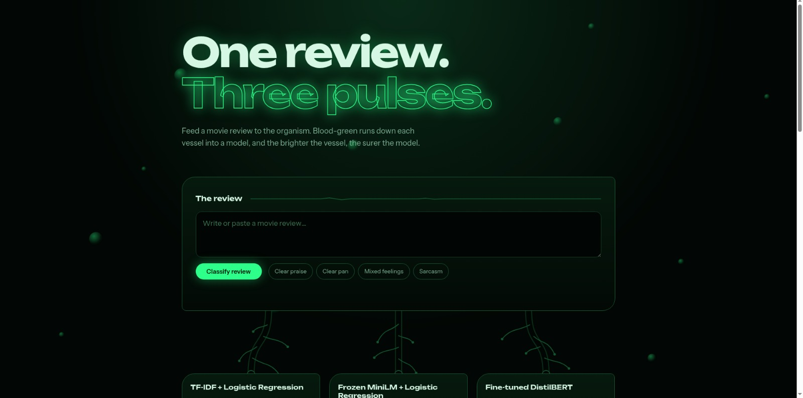
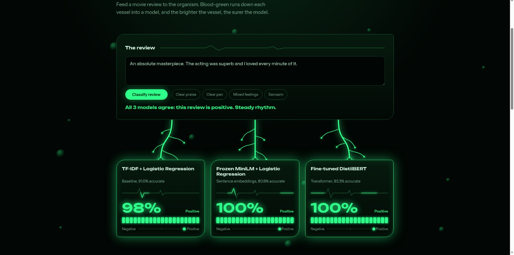
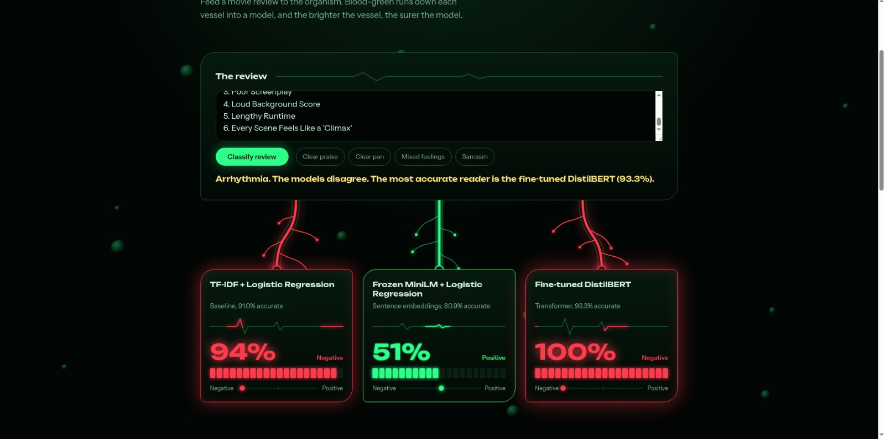
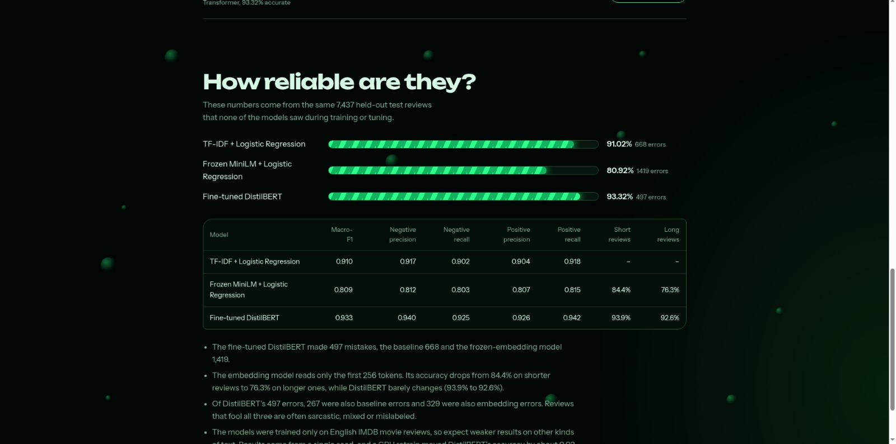
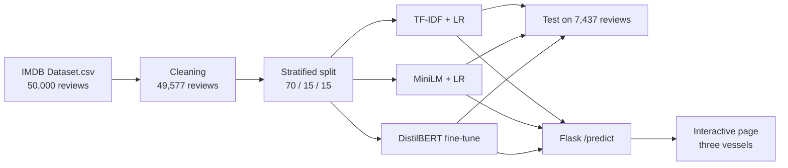

<div align="center">

# 🫀 Movie Review Sentiment Analysis

### One review. Three pulses.

Type a movie review and watch **three different models** read it side by side, from a classic TF-IDF baseline to a fine-tuned transformer.







[Overview](#-overview) · [Demo](#-demo) · [Results](#-results) · [How it works](#-how-it-works) · [Run it](#-run-it-locally) · [Structure](#-project-structure) · [Limitations](#-limitations) · [Team](#-team)

</div>

---

## ✨ Overview

Sentiment analysis labels a review as positive or negative. This project asks a simple question: **how much does a bigger model actually help?** It trains three classifiers on the same data, tests them on the same held-out reviews, and wraps them in an interactive page where you can try your own text and see where they agree or disagree.

| | Model | Idea |
|---|---|---|
| 1 | **TF-IDF + Logistic Regression** | Weighted word and word-pair counts. Fast, readable baseline. |
| 2 | **Frozen MiniLM + Logistic Regression** | Pretrained sentence embeddings (384-d), never updated; only the classifier on top is trained. |
| 3 | **Fine-tuned DistilBERT** | A transformer whose weights are all adapted to sentiment. Reads words in context. |

**Highlights**

- 🧬 **Live three-model prediction**: one review goes down three "vessels", one per model.
- 💡 **Confidence you can see**: vessel brightness and a LED bar show how sure each model is.
- ⚡ **Disagreement detector**: when models split, the page flags an "arrhythmia".
- 🔍 **Inside the project**: expand the real code and plots behind every model, right in the page.
- 📄 **Full report**: methodology, results and discussion in [`docs/`](docs/Movie_Review_Sentiment_Report.pdf).

---

## 🎬 Demo

<table>
<tr>
<td align="center" width="50%"><b>All models agree</b></td>
<td align="center" width="50%"><b>The models disagree</b></td>
</tr>
<tr>
<td></td>
<td></td>
</tr>
<tr>
<td align="center"><sub>Green = positive. 98%, 100%, 100%: "Steady rhythm."</sub></td>
<td align="center"><sub>Red = negative. MiniLM is only 51% sure, so its vessel is dim.</sub></td>
</tr>
</table>

> **Confidence is not accuracy.** The percentage on a card is how sure that model is about *this* review. The "accurate" figure under the model name is its score on the test set.

---

## 📊 Results

Held-out **test set of 7,437 reviews**, never used for training or tuning.

| Model | Accuracy | Errors | Macro-F1 |
|---|---:|---:|---:|
| TF-IDF + Logistic Regression *(baseline)* | 91.02% | 668 | 0.910 |
| Frozen MiniLM + Logistic Regression | 80.92% | 1,419 | 0.809 |
| **Fine-tuned DistilBERT** | **93.32%** | **497** | **0.933** |

<details>
<summary><b>Per-class precision and recall</b></summary>

| Model | Neg. precision | Neg. recall | Pos. precision | Pos. recall |
|---|---:|---:|---:|---:|
| TF-IDF + LR | 0.917 | 0.902 | 0.904 | 0.918 |
| Frozen MiniLM + LR | 0.812 | 0.803 | 0.807 | 0.815 |
| Fine-tuned DistilBERT | 0.940 | 0.925 | 0.926 | 0.942 |

</details>

**Takeaways**

- DistilBERT is the most accurate, with **171 fewer errors** than the baseline.
- The TF-IDF baseline is surprisingly strong (91.02%) for a model that trains in a fraction of the time.
- Frozen embeddings trail both: general-purpose sentence vectors, cut at 256 tokens, lose sentiment cues. Accuracy drops from 84.4% on shorter reviews to 76.3% on longer ones, while DistilBERT barely moves (93.9% to 92.6%).
- Results come from one split and one seed, so treat small gaps with care.

---

## 🧠 How it works



**Data.** Cleaning unescapes HTML, strips tags and URLs, drops reviews under 5 words, removes reviews with conflicting labels and exact duplicates. The classes stay almost balanced (24,695 negative, 24,882 positive).

**Training settings** (from the code shown in the app)

| | TF-IDF + LR | Frozen MiniLM + LR | DistilBERT |
|---|---|---|---|
| Features | 1-2 grams, sublinear tf, up to 300k | 384-d normalised, max 256 tokens | `distilbert-base-uncased`, max length 512 |
| Tuning | `C` on validation set | `C` by 5-fold stratified CV | best epoch by validation macro-F1 |
| Optimiser | none (liblinear) | none | AdamW, lr 2e-5, weight decay 0.01, 10% warm-up, 2 epochs, batch 16 |

**Serving.** `main.py` is a Flask app. On start-up it loads the three saved models. For each request to `POST /predict` it cleans the text, runs all three models on CPU and returns the probability of the positive class `p`. The page shows label = positive if `p ≥ 0.5` and confidence = `max(p, 1 − p)`.

> The accuracy bars and metrics table in the page are fixed numbers from the offline evaluation. Only the three prediction cards are live.

---

## 🚀 Run it locally

**Expected layout**

```
model_traning/
├── main.py
├── models/             # baseline*.joblib, embedding*.joblib, distilbert*.joblib
└── templates/
    └── index.html
└──README.md
└──docs
    └── Movie_Review_Sentiment_Report.pdf
    └── images/
```

**Install and start**

```bash
pip install flask joblib torch transformers sentence-transformers scikit-learn
python main.py
```

Open **http://127.0.0.1:5000**, type a review or tap one of the example chips (*Clear praise*, *Clear pan*, *Mixed feelings*, *Sarcasm*) and press **Classify review**.

<details>
<summary><b>Troubleshooting</b></summary>

- **A card says "Not loaded"**: its `.joblib` file is missing or was saved with different library versions. The server log prints the exact error and the versions it saw.
- **First start is slow**: the MiniLM encoder is downloaded the first time.
- **"Could not reach the models"**: open the page from `http://127.0.0.1:5000`, not by double-clicking `index.html`.

</details>

---

## 🗂 Project structure

| Path | Purpose |
|---|---|
| `main.py` | Flask backend: loads models, serves the page, `/predict` endpoint |
| `models/` | Saved baseline, embedding and DistilBERT models (`.joblib`) |
| `templates/index.html` | Single-page interface, with the code and plots embedded |
| `docs/Movie_Review_Sentiment_Report.pdf` | Full project report |
| `docs/screenshots/` | Images used in this README |

---

## ⚠️ Limitations

- English IMDb movie reviews only; other kinds of text will likely do worse.
- Binary labels: there is no neutral class, so mixed reviews are forced into one side.
- One data split and one seed; no repeated runs or confidence intervals.
- Confidence values are raw model probabilities and have not been calibrated.
- The app is a local development server, not a hosted service.

## 🔭 Future work

Repeated runs with confidence intervals · neutral or star-rating classes · calibration of probabilities · other pretrained encoders and longer context · a second review dataset · hosted deployment.

---

## 👥 Team

| Name | Roll no. |
|---|---|
| Gowtham Papani | EC24B1045 |
| Monish Kumar R | EC24B1051 |
| Varshith | EC24B1029 |

*Introduction to Data Science Engineering · Indian Institute of Information Technology, Design and Manufacturing, Kancheepuram*
